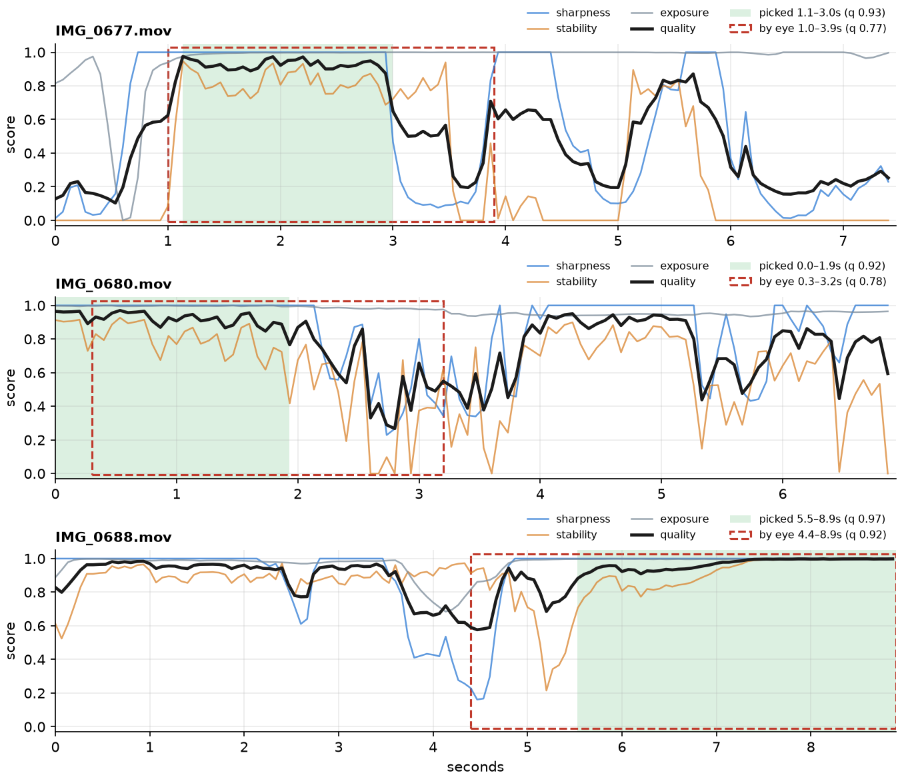

# aicut-analyzer

[](https://github.com/lanselylee/aicut-analyzer/actions/workflows/test.yml)

Footage analysis and automatic rough cuts for vlog editing. Two command-line tools:

- **`aicut-talk`** cuts a folder of talking-head clips into an editable rough cut. It removes pauses, filler words
  and retakes, keeps the best seconds of what is shown without talking, corrects the subtitles, and evens out the
  loudness. On 13 iPhone clips from one day of vlogging it cut **593 s of footage down to 145 s**.
- **`aicut-analyze`** measures which seconds of each clip are sharp, steady and well exposed, and which stretch of
  the clip is worth using.

Both tools are part of **AICUT**, an AI video editor. LLM-based editors pick shots by looking at a handful of
thumbnails, which is coarse, slow and expensive. This library gives them measured facts instead: word timings,
per-frame quality curves and proposed in/out points. The model then only has to decide the story.

```
footage ─▶ aicut-analyzer (deterministic, per frame / per word) ─▶ LLM (story, what is worth seeing) ─▶ edit ─▶ human review
```

The rough cuts are written as projects for [OpenFilm](https://github.com/openfilm/openfilm), an open-source video
editor whose timeline is a plain HTML file. A person can open the cut in OpenFilm Studio, fix it there and render it.
OpenFilm itself is not part of this repository.

## aicut-talk: talking-head rough cuts

```sh
uv sync --extra speech --extra llm        # Whisper on Apple silicon + Gemini
uv sync --extra asr --extra llm           # or Paraformer, more accurate for Mandarin
uv run aicut-talk path/to/clips/ --language zh --fix --env-file .env --story "a day of cooking for friends"
uv run aicut-talk talk.mov --music bed.mp3 --out my-cut      # one clip, with music lowered under the speech
uv run aicut-notes path/to/project                           # list the notes written on the cut in Studio
```

It prints every cut and the reason for it, so a cut can be checked before anyone trusts it.

| Step | What it does | How |
|---|---|---|
| Order | Puts clips in the order they were shot and splits scenes at gaps over 10 min | the camera's own creation time (`com.apple.quicktime.creationdate`), not file dates, which change when files are copied |
| Speech | Gets every word with its start and end time | Paraformer (FunASR) or mlx-whisper; known Whisper hallucinations are dropped (low log-probability, one character repeated, song credits) |
| Cut | Removes pauses over 0.4 s, fillers (嗯, 呃), stuttered words and earlier takes of a sentence said again | `keep_ranges()` and `retakes()`; a retake is found by prefix-matching a sentence against the start of a later one within 12 s |
| Cut points | Avoids clipping the edges of words | word edges tightened by loudness (Whisper stretches the first word after a pause into the silence), then snapped to the quietest nearby moment |
| Picture | Decides what to keep where nobody talks | Gemini watches a 360 px proxy of each clip and splits it into *talk / show / filler / camera adjustment*. Shows keep their best 1.5–3 s, and camera adjustments are cut. `--story` tells it what the film is about. `--watch local` uses face detection (YuNet) and motion instead, and uploads nothing |
| Subtitles | Fixes misheard words | Gemini listens to the clip and proposes fixes. A fix is accepted only if it **sounds like** the original (pinyin similarity), which rejects guesses made from context alone |
| Loudness | Makes the clips sound alike | speech to −16 LUFS (EBU R128), clips without speech to −23 LUFS, with a limiter, re-measured until they reach the target; music ducked under speech |
| Review | Lets a person ask for changes on the timeline | a notes track: sticky notes written in Studio stay pinned to their moment in the source, so they survive a new cut |

Speech recognition and Gemini results are cached on disk, and Gemini falls back to a lighter model when the service
is overloaded (HTTP 503). The tool refuses to write a project that OpenFilm Studio has open. Studio merges outside
writes with the person's own edits by clip id, and a new cut reuses those ids for different stretches, which
scrambles the film.

### Results and limits

Tested on my own iPhone vlogs in Mandarin:

- A single 118 s clip, talking while making a sandwich, came out at **56 s**. A folder of 13 clips came out at
  **145 s** from 593 s. A later run on 41 clips across three days produced a 6.8-minute film at −18.4 LUFS.
- On one of my vlogs I used it for the first cut and then edited by hand. That showed what it still misses:
  - `retakes()` missed an opening line said three times, because the takes were 16 s apart and some were cut off
    halfway.
  - Gemini's subtitle fixes are sometimes wrong in a way that still sounds alike (一份鸡汤 → 喝鸡汤).
  - In a long cooking stretch it kept too many short shows (26 in one clip).
  - Choosing *which* action to keep (for example, only the moment an item is picked up and dropped into a basket)
    still had to be done by hand.

## Sets and reps

`reps.py` finds where a person repeats a movement, counts the repetitions and finds where each one turns. It does
not need to see the person. Frames are shrunk to 24×24 and reduced to their first principal component. `SetFinder`
then looks for stretches where that signal repeats itself (autocorrelation), and `RepCounter` takes the turns of the
signal as the moments the movement stops and reverses. This works from angles and framings where a pose model
(MediaPipe) loses the body.

On 11 gym clips it found 8 sets and none in the b-roll (a weight stack, a ceiling). It trims the edges of sets
tightly and can undercount reps. Turns matter for editing as well as counting: a cut looks right where the movement is
still, not halfway through it. In my own cut of the same footage, every out-point landed at a moment of near-zero
motion.

## Film-stock grading

`grade.py` builds film-stock looks: Kodak Portra 400, Vision3 500T, and Fuji Classic Chrome and Classic Neg. The
colour work is done in OKLab with skin tones protected. It matches brightness per clip, converts HLG (HDR) footage
to SDR, exports `.cube` LUTs and applies them with ffmpeg, adding halation, sharpening and a vignette.

## aicut-analyze: footage quality



*Three real clips. Black: the blended quality score; green: the stretch the analyzer picks; red dashes: the stretch
chosen by eye from thumbnails. In the bottom clip the eye's cut starts inside a motion-blur dip (4.4–4.7 s) that the
analyzer avoids; in the middle one the analyzer keeps a steady but dull shot of a lid, where the eye kept the moment
the drink turns to the camera.*

### Usage

Requires Python 3.12+ and [uv](https://docs.astral.sh/uv/).

```sh
uv sync
uv run aicut-analyze path/to/footage/                         # a table of scores and the best stretch per clip
uv run aicut-analyze path/to/footage/ --json report.json      # plus the full per-frame curves
uv run aicut-analyze path/to/footage/ --film film.html        # compare with the cuts of an existing edit
uv sync --extra plot
uv run aicut-analyze path/to/footage/ --film film.html --plot curves.png --clips A.mov B.mov   # draw the curves
```

`--film` reads an [OpenFilm](https://github.com/openfilm/openfilm) `film.html` and puts its trims (`#t=in,out`) next
to the analyzer's, to see where the numbers and a human (or an LLM) disagree.

### How it works

Each clip is sampled at 15 frames per second, scaled to 360 px on its short side. Three analyzers score every frame
from 0 to 1:

| Analyzer | Measures | Method |
|---|---|---|
| `SharpnessAnalyzer` | focus and motion blur | variance of the Laplacian, relative to the sharpest frames within ±1 s |
| `StabilityAnalyzer` | hand shake | global shift between frames by phase correlation; shake is the jitter left after smoothing the camera path, so a steady pan is not penalized |
| `ExposureAnalyzer` | blown highlights, crushed shadows | share of pixels near pure white or black |

`QualityScorer` blends them (weights 0.45 / 0.40 / 0.15), and `WindowPicker` finds the stretch of 1 to 5 seconds with
the best mean quality and no bad frame inside.

#### Design

```
FrameSampler ──▶ Clip(frames)
                   │
QualityScorer ─────┤  uses any number of Analyzer strategies
  ├─ SharpnessAnalyzer   ┐
  ├─ StabilityAnalyzer   ├─ Analyzer (ABC): raw(clip) → values, score(values) → [0, 1]
  └─ ExposureAnalyzer    ┘
                   ▼
               ClipReport ──▶ WindowPicker ──▶ best (in, out), usable?
```

Analyzers follow the Strategy pattern: adding a signal (faces, smiles, duplicate shots, semantic content) is a new
`Analyzer` subclass; the scorer and the picker do not change. Raw values are kept next to scores so that thresholds can
be tuned against real footage.

### Findings so far

Tested on 12 iPhone clips (52 s) of an autumn walk, against cuts chosen by eye for a 35-second vlog:

- **Agreement on 7 of 12 clips**, within half a second.
- **Better than the eye on 2**: it trimmed 0.9 s of motion blur and 1.1 s of a shaky door handle that the
  thumbnail-based cut kept.
- **Worse on 3**, which shows what a quality score cannot do alone:
  - *Quality is not content.* On a clip of a drink, it chose the steady shot of the lid over the moment the cup turns
    to show the green matcha, the moment worth keeping.
  - *Some motion is intended.* A walking point-of-view shot and a walking selfie score as shaky, though their motion
    is the style.
- **A calibration lesson**: absolute Laplacian variance measures how much detail a scene has (bare branches against
  the sky: 6000; a portrait-mode selfie: 76; both in focus). Judging each frame against the whole clip then mistook a
  walk from detailed trees to plain pavement for blur. Judging it against its neighbours (±1 s) fixed that.

## Tests

```sh
uv sync --extra plot --extra llm
uv run pytest        # 179 tests, no network or models needed
```

The analyzers are tested on synthetic footage with known defects (`tests/synthetic.py`): a textured scene seen
through a moving crop, with Gaussian blur, random camera jitter or overexposure added to chosen frames. The tests
check that each defect lowers its own score where it was added and nowhere else, that a steady pan is not taken for
shake, and that a scene with less detail is not taken for blur. One test keeps the old whole-clip sharpness reference
to show it fails that case. An end-to-end test encodes a clip to MP4 and checks the picked stretch avoids its shaky
and blurred seconds.

The speech, picture and loudness steps are tested without calling Whisper, Paraformer or Gemini. The tests build word
timings and judged segments by hand and check the cut that follows from them: pauses, fillers, repeats and retakes
removed, camera adjustments cut without cutting through a word, notes following their moment into a new cut, and
loudness measured and leveled on synthesized audio. The subtitle guard is tested on pairs of words that do and do
not sound alike. `reps.py` is tested on synthetic workout footage with known rep ends, which it must find to within
two sampled frames.

## Roadmap

- [x] Generate an OpenFilm `film.html` from the analysis (`aicut-talk`)
- [ ] Action-aware cutting: keep the moment of an action (picked up, dropped in) and group shots by action
- [ ] Measure cuts against my own hand edits (cut-point error, overlap of kept stretches)
- [ ] Catch retakes further apart and retakes cut off halfway
- [ ] Semantic analyzer (CLIP embeddings): what is in the frame and how good it looks
- [ ] Shot-type detection, so intended motion (walking POV, selfies) is not scored as shake
- [ ] Beat detection on the music track, to align cuts to the music

## License

MIT
