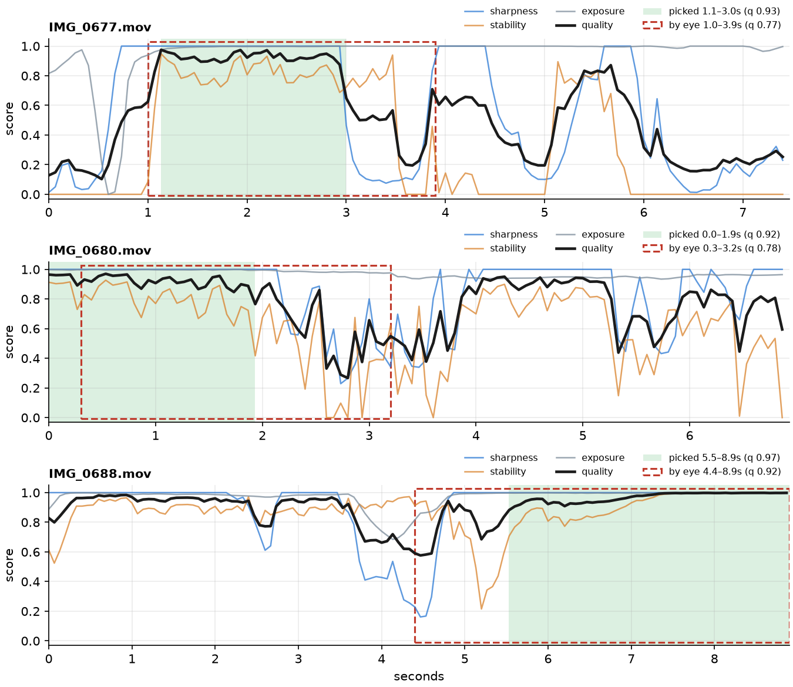

# aicut-analyzer

[](https://github.com/lanselylee/aicut-analyzer/actions/workflows/test.yml)

Footage quality analysis for vlog editing: which seconds of each clip are sharp, steady and well exposed, and which
stretch of the clip is worth using.

Part of **AICUT**, an AI video editor. LLM-based editors pick shots by looking at a handful of thumbnails, which is
coarse, slow and expensive. This library gives them measured facts instead: a per-frame quality curve for every clip
and a proposed in/out point, so the model only has to decide the story.

```
footage ─▶ aicut-analyzer (deterministic, per frame) ─▶ quality report ─▶ LLM (story, order) ─▶ edit ─▶ human review
```



*Three real clips. Black: the blended quality score; green: the stretch the analyzer picks; red dashes: the stretch
chosen by eye from thumbnails. In the bottom clip the eye's cut starts inside a motion-blur dip (4.4–4.7 s) that the
analyzer avoids; in the middle one the analyzer keeps a steady but dull shot of a lid, where the eye kept the moment
the drink turns to the camera.*

## Usage

Requires Python 3.12+ and [uv](https://docs.astral.sh/uv/).

```sh
uv sync
uv run aicut-analyze path/to/footage/                         # a table of scores and the best stretch per clip
uv run aicut-analyze path/to/footage/ --json report.json      # plus the full per-frame curves
uv run aicut-analyze path/to/footage/ --film film.html        # compare with the cuts of an existing edit
uv sync --extra plot
uv run aicut-analyze path/to/footage/ --film film.html --plot curves.png --clips A.mov B.mov   # draw the curves
```

`--film` reads an [OpenFilm](https://github.com/openfilm/openfilm) `film.html` and puts its trims (`#t=in,out`) next
to the analyzer's, to see where the numbers and a human (or an LLM) disagree.

## How it works

Each clip is sampled at 15 frames per second, scaled to 360 px on its short side. Three analyzers score every frame
from 0 to 1:

| Analyzer | Measures | Method |
|---|---|---|
| `SharpnessAnalyzer` | focus and motion blur | variance of the Laplacian, relative to the sharpest frames within ±1 s |
| `StabilityAnalyzer` | hand shake | global shift between frames by phase correlation; shake is the jitter left after smoothing the camera path, so a steady pan is not penalized |
| `ExposureAnalyzer` | blown highlights, crushed shadows | share of pixels near pure white or black |

`QualityScorer` blends them (weights 0.45 / 0.40 / 0.15), and `WindowPicker` finds the stretch of 1 to 5 seconds with
the best mean quality and no bad frame inside.

### Design

```
FrameSampler ──▶ Clip(frames)
                   │
QualityScorer ─────┤  uses any number of Analyzer strategies
  ├─ SharpnessAnalyzer   ┐
  ├─ StabilityAnalyzer   ├─ Analyzer (ABC): raw(clip) → values, score(values) → [0, 1]
  └─ ExposureAnalyzer    ┘
                   ▼
               ClipReport ──▶ WindowPicker ──▶ best (in, out), usable?
```

Analyzers follow the Strategy pattern: adding a signal (faces, smiles, duplicate shots, semantic content) is a new
`Analyzer` subclass; the scorer and the picker do not change. Raw values are kept next to scores so that thresholds can
be tuned against real footage.

## Tests

```sh
uv run pytest
```

The analyzers are tested on synthetic footage with known defects (`tests/synthetic.py`): a textured scene seen
through a moving crop, with Gaussian blur, random camera jitter or overexposure added to chosen frames. The tests
check that each defect lowers its own score where it was added and nowhere else, that a steady pan is not taken for
shake, and that a scene with less detail is not taken for blur. One test keeps the old whole-clip sharpness reference
to show it fails that case. An end-to-end test encodes a clip to MP4 and checks the picked stretch avoids its shaky
and blurred seconds.

## Findings so far

Tested on 12 iPhone clips (52 s) of an autumn walk, against cuts chosen by eye for a 35-second vlog:

- **Agreement on 7 of 12 clips**, within half a second.
- **Better than the eye on 2**: it trimmed 0.9 s of motion blur and 1.1 s of a shaky door handle that the
  thumbnail-based cut kept.
- **Worse on 3**, which shows what a quality score cannot do alone:
  - *Quality is not content.* On a clip of a drink, it chose the steady shot of the lid over the moment the cup turns
    to show the green matcha, the moment worth keeping.
  - *Some motion is intended.* A walking point-of-view shot and a walking selfie score as shaky, though their motion
    is the style.
- **A calibration lesson**: absolute Laplacian variance measures how much detail a scene has (bare branches against
  the sky: 6000; a portrait-mode selfie: 76; both in focus). Judging each frame against the whole clip then mistook a
  walk from detailed trees to plain pavement for blur. Judging it against its neighbours (±1 s) fixed that.

## Roadmap

- [ ] Semantic analyzer (CLIP embeddings): what is in the frame and how good it looks
- [ ] Shot-type detection, so intended motion (walking POV, selfies) is not scored as shake
- [ ] Duplicate and near-duplicate shot detection
- [ ] Beat detection on the music track, to align cut lengths
- [ ] Color statistics per clip, to match grades across shots
- [ ] Generate an OpenFilm `film.html` from the report and an LLM's story plan

## License

MIT
